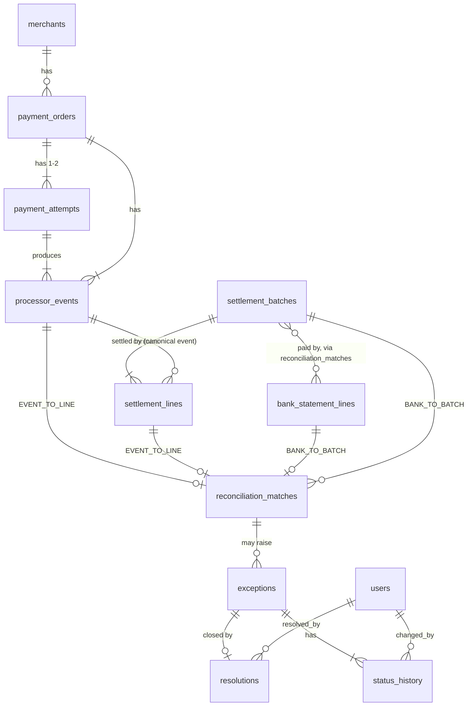
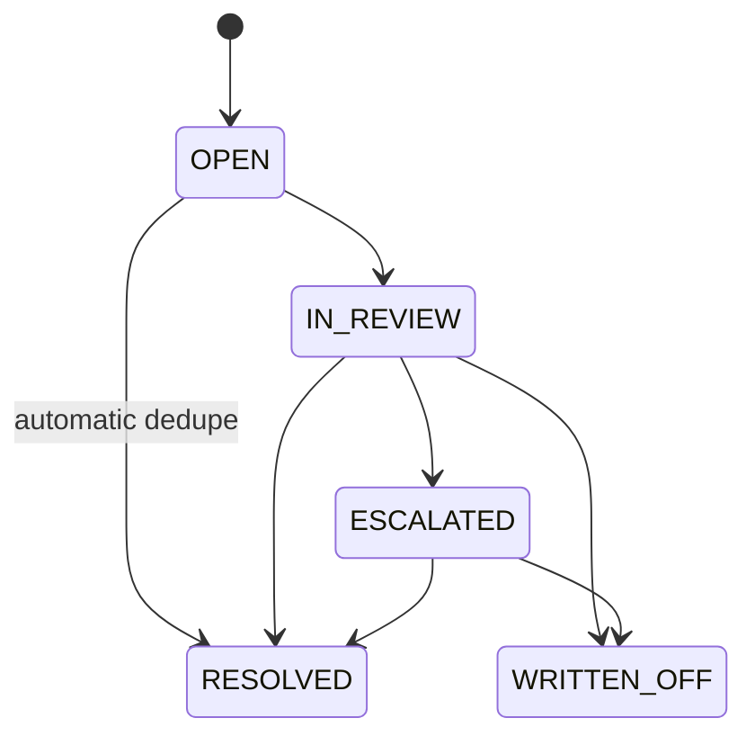

# Entities, relationships and lifecycles

Field-level detail (type, required, allowed values, units, uniqueness, rule) is in [`data_dictionary.md`](data_dictionary.md),
generated from `app/services/schema.py`. The ten entities of the brief are merchants, payment_orders, payment_attempts,
processor_events, settlement_batches, settlement_lines, bank_statement_lines, reconciliation_matches, exceptions and
resolutions. Two small support tables are added: `users` (who resolves) and `status_history` (exception history).

## Cardinalities (1:1, 1:N, N:M, optional)

| relationship | cardinality | notes |
|---|---|---|
| merchants - payment_orders | 1:N | the order's currency equals the merchant's settlement currency |
| payment_orders - payment_attempts | 1:N (1 or 2) | a second attempt only follows a decline |
| payment_attempts - processor_events | 1:N | declined: 1 event; otherwise authorised, then captured |
| payment_orders - processor_events | 1:N | refunds belong to the order's capture |
| processor_events - settlement_lines | 1:0..1 | none for declines, authorisations and dropped captures; 2 only in the duplicate-line fault |
| settlement_batches - settlement_lines | 1:N | a batch is one currency |
| settlement_batches - bank_statement_lines | **N:M** through `reconciliation_matches` | a batch is paid in several tranches; each bank line belongs to at most one batch; orphan bank lines belong to none (optional) |
| reconciliation_matches | bridge | `BANK_TO_BATCH` rows (bank line, batch) and `EVENT_TO_LINE` rows (event, line) |
| reconciliation_matches - exceptions | 1:0..N | an exception may have no match (nothing to match against) |
| exceptions - resolutions | 1:0..1 | a resolution exists only once the exception is closed |
| exceptions - status_history | 1:N | append-only |

## Lifecycles and effective dates

| entity | states | effective dates |
|---|---|---|
| merchant | active from `onboarded_date` | `onboarded_date` (before the first order) |
| payment order | FAILED (no capture), or CAPTURED -> PARTIALLY_REFUNDED -> REFUNDED | `order_ts`; the state changes are the `processor_events` rows |
| settlement batch | cut off, then paid out | `cutoff_ts`, `expected_payout_date` |
| bank line | booked | `value_date`, `booking_date` (>= value date) |
| exception | OPEN -> IN_REVIEW -> ESCALATED -> RESOLVED or WRITTEN_OFF (OPEN -> RESOLVED for automatic dedupe) | `detected_at`, `sla_due_at`, resolved time in `resolutions` |

